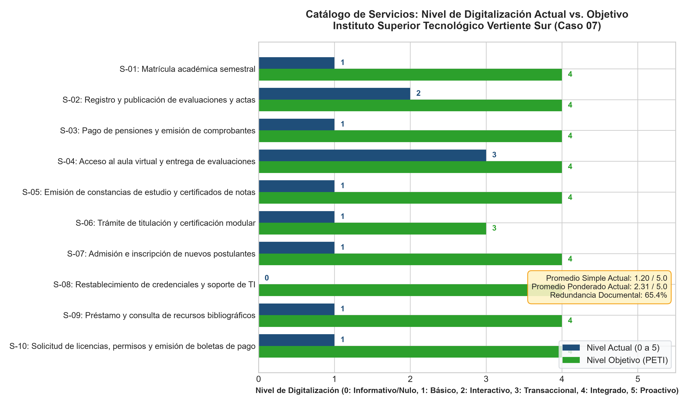
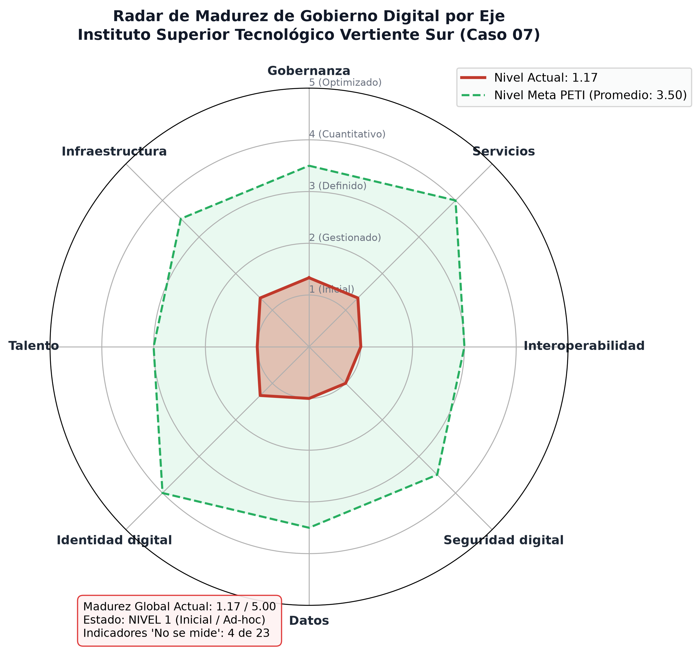
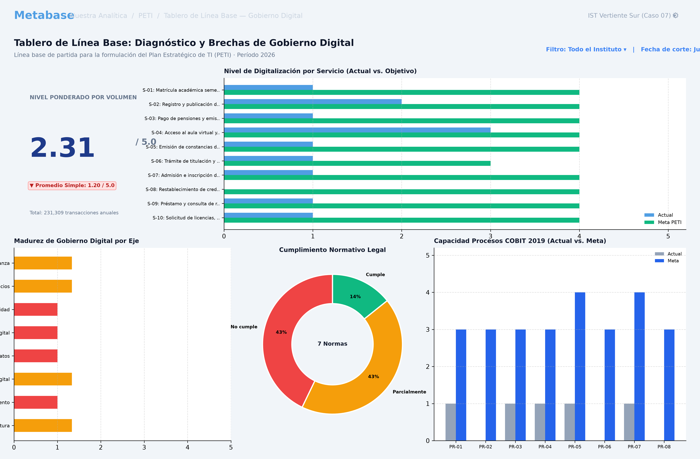
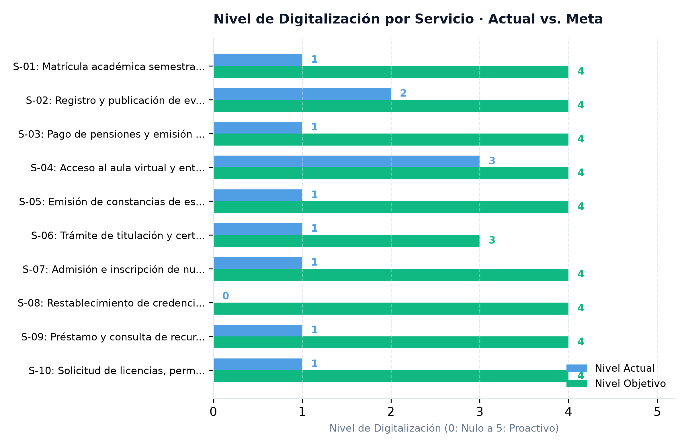
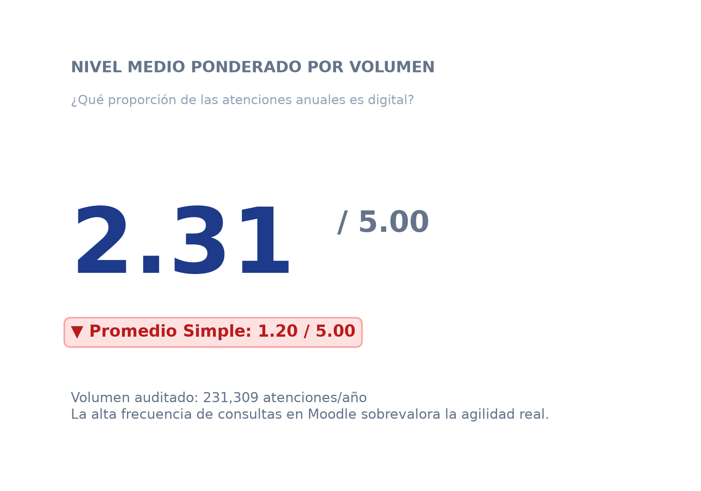
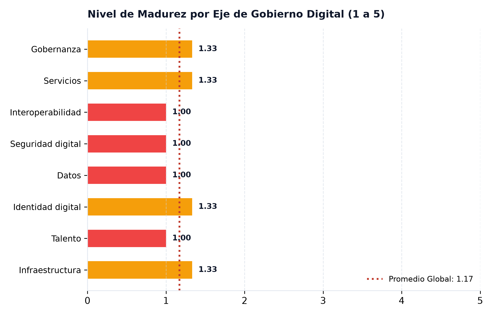
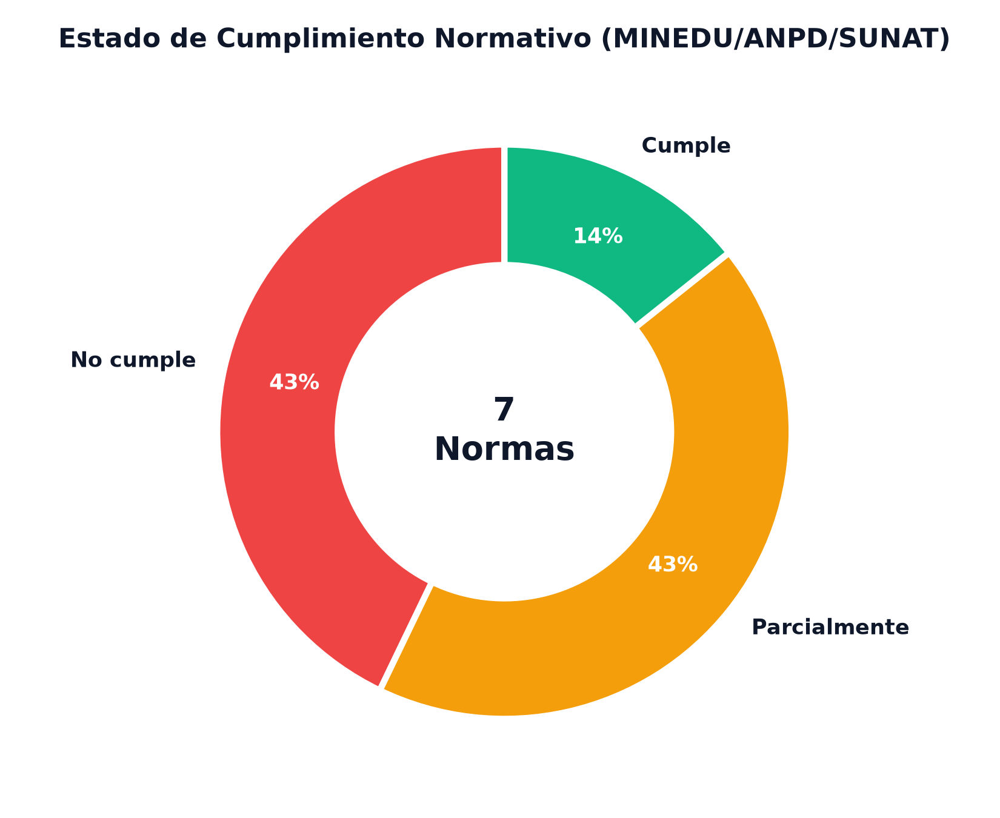
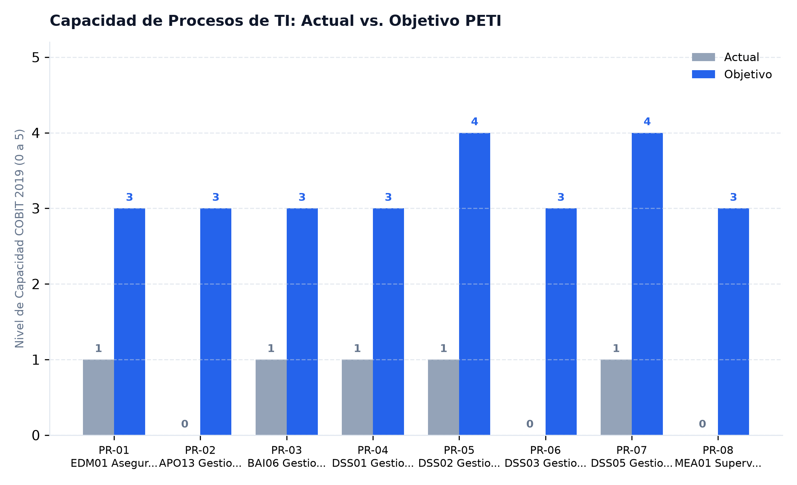
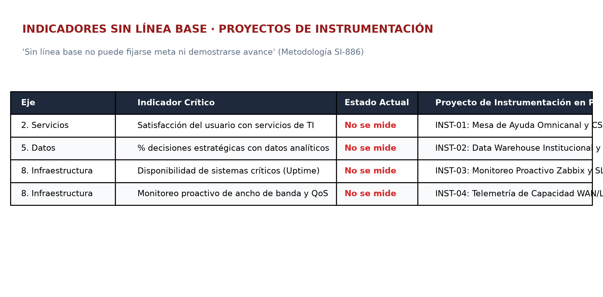

<div align="center">

# UNIVERSIDAD PRIVADA DE TACNA
### FACULTAD DE INGENIERÍA
### ESCUELA PROFESIONAL DE INGENIERÍA DE SISTEMAS

---

## INFORME DE LABORATORIO · TALLER SEMANA 11
# Diagnóstico de Gobierno Digital y Tablero de Línea Base
### Plan Estratégico de Tecnologías de Información (PETI) · Versión 0.11

**CASO ASIGNADO: EMPRESA 07 · INSTITUTO SUPERIOR TECNOLÓGICO VERTIENTE SUR**

---

**CURSO:** SI-886 · Planeamiento Estratégico de TI  
**DOCENTE:** Dr. Oscar Juan Jimenez Flores  

**AUTOR(ES) · GRUPO 07:**
- **Laos González, Adriana Rafaela** — `2023077474`
- **Ramos Loza, Mariela Estefany** — `2023077478`
- **Calloticona Chambilla, Marymar Danytza** — `2023076791`
- **Choqueña Choque, Mauricio Arian** — `2023076799`

**TACNA — PERÚ**  
**2026**

---

</div>

## Índice General

1. [Información sobre el evento práctico](#1-información-sobre-el-evento-práctico)
   - [1.1 Título del evento práctico](#11-título-del-evento-práctico)
   - [1.2 Objetivos](#12-objetivos)
   - [1.3 Tiempo de duración](#13-tiempo-de-duración)
   - [1.4 Resultados de aprendizaje](#14-resultados-de-aprendizaje)
   - [1.5 Recursos utilizados](#15-recursos-utilizados)
   - [1.6 Normas de seguridad y confidencialidad](#16-normas-de-seguridad-y-confidencialidad)
2. [Procedimiento o metodología](#2-procedimiento-o-metodología)
   - [Paso A — Catálogo de servicios y su nivel de digitalización](#paso-a--catálogo-de-servicios-y-su-nivel-de-digitalización)
   - [Paso B — Diagnóstico de los ocho ejes con línea base](#paso-b--diagnóstico-de-los-ocho-ejes-con-línea-base)
   - [Paso C — Tablero de línea base en Metabase](#paso-c--tablero-de-línea-base-en-metabase)
   - [Paso D — Redacción de la Sección 6.1 del PETI](#paso-d--redacción-de-la-sección-61-del-peti)
   - [Paso E — Validar y corregir](#paso-e--validar-y-corregir)
   - [Paso F — Registrar la evidencia y cerrar](#paso-f--registrar-la-evidencia-y-cerrar)
3. [Resultados](#3-resultados)
   - [3.1 Los tres resultados que se califican](#31-los-tres-resultados-que-se-califican)
   - [3.2 Lista de comprobación del taller](#32-lista-de-comprobación-del-taller)
   - [3.3 Evaluación de la rúbrica procedimental (20 puntos)](#33-evaluación-de-la-rúbrica-procedimental-20-puntos)
   - [3.4 Problemas identificados y oportunidades de mejora](#34-problemas-identificados-y-oportunidades-de-mejora)
4. [Conclusiones](#4-conclusiones)
5. [Cuestionario](#5-cuestionario)
6. [Referencias bibliográficas](#6-referencias-bibliográficas)
7. [Anexos](#7-anexos)

---

## 1. Información sobre el evento práctico

### 1.1 Título del evento práctico
Diagnóstico de gobierno digital, formulación del catálogo de servicios, evaluación de línea base en ocho ejes y construcción del tablero de supervisión en Metabase para el **Instituto Superior Tecnológico Vertiente Sur (Caso 07)**.

### 1.2 Objetivos
- Levantar el **catálogo de servicios** de la organización con su nivel de digitalización (escala 0 a 5) y volúmenes anuales.
- Evaluar los **ocho ejes** del gobierno digital peruano con evidencias tangibles y fuentes fechadas.
- Establecer la **línea base** numérica de cada indicador institucional o declarar explícitamente «No se mide».
- Determinar el **nivel de madurez de gobierno digital** de la organización en el modelo de cinco niveles.
- Aplicar la prueba del **principio de una sola vez** (Once-Only Principle), cuantificando la redundancia documental.
- Construir el **tablero de línea base** en Metabase con al menos seis visualizaciones sobre PostgreSQL.
- Redactar la **Sección 6.1** del Plan Estratégico de Tecnologías de Información (PETI).

### 1.3 Tiempo de duración
100 minutos en sesión síncrona de laboratorio de cómputo, complementados con horas de trabajo de campo, modelamiento analítico y desarrollo colaborativo en GitHub.

### 1.4 Resultados de aprendizaje
- Capacidad para auditar el ecosistema de servicios tecnológicos de una institución educativa privada bajo los marcos de MINEDU, SUNEDU, ANPD (Ley 29733) y PCM/SEGDI.
- Destreza en el cálculo del nivel medio ponderado por volumen transaccional frente al promedio aritmético simple.
- Competencia para identificar procesos ciegos y estructurar proyectos de instrumentación técnica en el PETI.
- Habilidad para desplegar arquitecturas analíticas con Docker, bases de datos relacionales y plataformas de inteligencia de negocios (Metabase).

### 1.5 Recursos utilizados

| Recurso | Versión | Para qué se usó en el taller |
|---|---|---|
| **Docker Engine / Desktop** | 26.1 / Linux Containers | Despliegue de los contenedores locales de PostgreSQL y Metabase. |
| **PostgreSQL** | 16.2-alpine | Base de datos relacional analítica receptora de las cuatro matrices del taller (puerto `5433`). |
| **Metabase BI** | v0.49.5 | Construcción del tablero de línea base con las seis visualizaciones mínimas (puerto `3001`). |
| **Python / pandas / matplotlib** | 3.14.0 | Procesamiento estadístico de brechas ponderadas, redundancia documental y radares polares. |
| **SQLAlchemy & psycopg2** | 2.1.6 / 2.9.13 | Ingesta y persistencia automatizada de CSVs hacia PostgreSQL en `GD05_carga_tablero.py`. |
| **Plantilla Oficial UPT** | `SI886-PLANTILLA-TALLER.docx` | Formato normativo de entrega institucional con carátula y estructura EPIS. |

### 1.6 Normas de seguridad y confidencialidad
1. **Confidencialidad:** El catálogo de servicios, volúmenes de atención y vulnerabilidades de control del Instituto Superior Tecnológico Vertiente Sur son tratados bajo reserva con fines académicos.
2. **Seguridad y Privacidad (Ley 29733):** El tablero se despliega en local (`127.0.0.1`) con datos agregados; no se almacenan datos personales identificatorios de los 3 240 alumnos ni de los 200 colaboradores.
3. **Tratamiento de Vulnerabilidades:** Los incidentes críticos (como la alteración no autorizada de 17 notas) se reportan a nivel de proceso y control de acceso, sin publicar vectores de ataque explotables.
4. **Integridad:** La observación de los servicios se efectuó sobre interfaces estándar de usuario sin alterar los registros académicos institucionales.

---

## 2. Procedimiento o metodología

### Paso A — Catálogo de servicios y su nivel de digitalización

A partir de la Ficha Institucional ([DOCS/FICHA.md](DOCS/FICHA.md)) y el registro de mesa de servicio con 2 299 tickets anuales ([DOCS/mesa-de-servicio-y-sla.md](DOCS/mesa-de-servicio-y-sla.md)), se estructuró el catálogo de diez (10) servicios que sustentan los procesos académicos y administrativos del instituto.

**Archivo en el repositorio:** [`06_gobierno_digital/GD01_catalogo_servicios.csv`](06_gobierno_digital/GD01_catalogo_servicios.csv)

| ID | Servicio | Usuario Destinatario | Volumen Anual | Nivel Actual (0–5) | Canales | Tiempo Atención | Doc. Solicitados | Redundantes (en poder entidad) | Sistemas de Soporte | Datos Pers. | Nivel Meta | Justificación de la Meta |
|---|---|---|:---:|:---:|---|---|:---:|:---:|---|:---:|:---:|---|
| **S-01** | Matrícula académica semestral | Estudiante | 6 480 | **1** | Ventanilla presencial (85%), Intranet preliminar (15%) | 3 a 5 días | 4 | 3 | Sistema académico, Cobranzas | Sí | **4** | Servicio troncal de mayor fricción; 100% digital elimina colas. |
| **S-02** | Registro y publicación de actas | Docente / Estudiante | 45 360 | **2** | Intranet local, entrega de acta física | 7 días hábiles | 2 | 2 | Sistema académico | Sí | **4** | Firma digital; erradica vulnerabilidad de alteración ilícita de notas. |
| **S-03** | Pago de pensiones y comprobantes | Estudiante / Apoderado | 32 400 | **1** | Caja física (60%), Banco voucher diferido (40%) | 24 a 48 h | 2 | 1 | Cobranzas y Tesorería | Sí | **4** | Pasarela online y conciliación contable en tiempo real. |
| **S-04** | Aula virtual y entrega de tareas | Estudiante / Docente | 129 600 | **3** | Plataforma web Moodle autoalojada | Inmediato / 4 d soporte | 0 | 0 | Moodle servidor local | Sí | **4** | Plataforma crítica; sincronización LDAP/SSO y nube. |
| **S-05** | Emisión de constancias y notas | Estudiante / Egresado | 2 100 | **1** | Mesa de partes física valorada | 10 días hábiles | 3 | 3 | Sistema académico, Mesa partes | Sí | **4** | Autoservicio con QR; reduce plazo de 10 días a 2 minutos. |
| **S-06** | Trámite de titulación profesional | Egresado | 480 | **1** | Ventanilla física (expediente 30+ folios) | 45 a 60 días | 7 | 5 | Sistema académico, legajo | Sí | **3** | Expediente digital y seguimiento en línea de dictámenes. |
| **S-07** | Admisión nuevos postulantes | Postulante externo | 1 450 | **1** | Formulario web + entrega física en campus | 48 horas | 4 | 0 | Módulo web, Sistema académico | Sí | **4** | Inscripción online con validación RENIEC y pago integrado. |
| **S-08** | Restablecimiento credenciales | Comunidad institucional | 2 299 | **0** | Teléfono interno, WhatsApp, presencial | 24 a 72 horas | 1 | 1 | Atención manual en TI | Sí | **4** | Autoservicio 2FA/MFA; descongestiona 30% de llamadas. |
| **S-09** | Préstamo biblioteca y catálogo | Estudiante / Docente | 8 500 | **1** | Mostrador físico en biblioteca | 15 min mostrador | 1 | 1 | PC aislada en biblioteca | Sí | **4** | Catálogo OPAC web y repositorio digital para las 7 carreras. |
| **S-10** | Licencias y boletas de pago | Personal y Docentes | 2 640 | **1** | Oficina RRHH en papel firmado | 3 días hábiles | 2 | 1 | Módulo planillas en servidor | Sí | **4** | Portal empleado con firma electrónica; cumple norma laboral. |

Se ejecutó el programa [`06_gobierno_digital/GD02_analisis_servicios.py`](06_gobierno_digital/GD02_analisis_servicios.py):

```bash
cd 06_gobierno_digital && python GD02_analisis_servicios.py
```

**Salida pericial del script (`evidencias/S11/salidas/GD02_salida.txt`):**
```text
================================================================================
INSTITUTO SUPERIOR TECNOLÓGICO VERTIENTE SUR - AUDITORÍA DE GOBIERNO DIGITAL
REPORTE GD02: ANÁLISIS DEL CATÁLOGO DE SERVICIOS Y NIVELES DE DIGITALIZACIÓN
================================================================================
Total de servicios catalogados: 10
Volumen transaccional anual auditado: 231,309 atenciones/año

1. DIAGNÓSTICO DE DIGITALIZACIÓN (NIVEL 0 A 5):
   • Nivel medio simple actual:       1.20 de 5.00
   • Nivel medio ponderado actual:    2.31 de 5.00
   • Nivel medio simple objetivo:     3.90 de 5.00
   • Nivel medio ponderado objetivo:  4.00 de 5.00
   --> Brecha de digitalización global ponderada: 1.69 puntos

2. PRUEBA DEL PRINCIPIO DE UNA SOLA VEZ (ONCE-ONLY PRINCIPLE):
   • Total de documentos solicitados a usuarios:        26
   • Documentos solicitados que YA POSEE la institución: 17
   • Índice de redundancia documental institucional:    65.38 %
   --> Dictamen: INEFICIENCIA CRÍTICA. Casi 2 de cada 3 requisitos exigidos
       ya constan en los registros académicos, contables o legajos del instituto.

3. RANKING DE SERVICIOS POR BRECHA PONDERADA (TOP 5 DE MAYOR IMPACTO):
ID     Servicio                               Volumen    Act   Obj   Brecha Pond    % Impacto
----------------------------------------------------------------------------------------
S-04   Acceso al aula virtual y entrega de    129,600    3     4     129,600        33.13 %
S-03   Pago de pensiones y emisión de compr   32,400     1     4     97,200         24.85 %
S-02   Registro y publicación de evaluacion   45,360     2     4     90,720         23.19 %
S-09   Préstamo y consulta de recursos bibl   8,500      1     4     25,500         6.52  %
S-01   Matrícula académica semestral          6,480      1     4     19,440         4.97  %
----------------------------------------------------------------------------------------
Top 5 concentra el 92.66% del esfuerzo de transformación digital.
================================================================================
```

#### Hallazgos Analíticos Clave
1. **Contraste de Promedios:** El promedio simple (1.20) demuestra que 9 de cada 10 servicios están anclados en colas de ventanilla. El promedio ponderado (2.31) se encuentra sobrevalorado por el uso intensivo de foros y tareas en Moodle (129 600 accesos en Nivel 3), ocultando que los trámites troncales de matrícula, pagos y notas operan en niveles 1 y 0.
2. **Principio de «Una Sola Vez»:** De 26 requisitos exigidos, **17 ya obran en la institución (65.38% de redundancia)**. El instituto solicita DNI ya registrado al ingresar, fichas que su propio sistema emite y vouchers de pagos que figuran en su base contable.
3. **Concentración de Brechas:** El Top 5 concentra el **92.66% del esfuerzo global**.


*Figura 1. Comparativo del nivel de digitalización actual frente al objetivo del PETI por servicio. Fuente: Elaboración propia mediante GD02_analisis_servicios.py (2026).*

---

### Paso B — Diagnóstico de los ocho ejes con línea base

Se evaluaron los ocho ejes del gobierno digital peruano mediante 23 indicadores técnicos y de gestión.

**Archivo en el repositorio:** [`06_gobierno_digital/GD03_ejes.csv`](06_gobierno_digital/GD03_ejes.csv)

| Eje de Gobierno Digital | Indicador Clave | Línea Base (2026) | Fuente y Fecha | Evidencia | Nivel | Observación / Situación Detectada |
|---|---|---|---|---|:---:|---|
| **1. Gobernanza** | ¿Comité de TI formal con actas y reuniones? | **No** (Existe en papel, 0 reuniones) | Entrevista Dirección, jun 2026 | Sin actas en archivo | 1 | Inexistencia de liderazgo corporativo para priorizar. |
| **1. Gobernanza** | ¿Plan de TI (PETI) vigente? | **No** | Archivo institucional | Sin registro | 1 | Este PETI será el primero formulado en 16 años. |
| **1. Gobernanza** | % presupuesto institucional asignado a TI | **1.81 %** (S/ 356K de S/ 19.7M) | Presupuesto 2025 | Reporte contable | 2 | Por debajo del benchmark educativo privado (3.5%-5%). |
| **2. Servicios** | Nivel medio ponderado de digitalización | **2.31 de 5.00** | Script GD02 | Matriz GD01 | 2 | Ventanilla analógica; distorsionado por Moodle. |
| **2. Servicios** | % trámites 100% digitales (cero papel) | **0 %** | Auditoría mesa de partes | TUPA institucional | 1 | Todos exigen firma física o presencialidad en campus. |
| **2. Servicios** | Satisfacción de usuarios con servicios TI | **No se mide** | Cuestionario diagnóstico | Instrumento no validado | 1 | **Primer proyecto: Implementar CSAT/NPS.** |
| **3. Interoperabilidad** | N.º integraciones automáticas entre sistemas | **0** (Sistemas aislados) | Inspección arquitectura | Diagrama de sistemas | 1 | Transferencia manual de archivos planos (CSV). |
| **3. Interoperabilidad** | Interoperabilidad con plataformas Estado | **0** (Carga manual SIAGIE) | Secretaría Académica | Sin Web Services | 1 | Sin integración con PIDE, RENIEC ni SUNAT. |
| **3. Interoperabilidad** | Proporción de documentos redundantes | **65.38 %** (17 de 26) | Script GD02 | Catálogo GD01 | 1 | Severa transgresión del principio de una sola vez. |
| **4. Seguridad Digital** | ¿Existe SGSI formalizado bajo ISO 27001? | **No** | Diagnóstico normativo | Sin políticas escritas | 1 | Exposición crítica ante la ANPD (Ley 29733). |
| **4. Seguridad Digital** | Incidentes de seguridad reportados formalmente | **0 registrados** (1 crítico admitido) | Ficha Sección G | 17 notas alteradas | 1 | Subregistro total; 17 notas alteradas impunemente. |
| **4. Seguridad Digital** | % sistemas críticos con restauración probada | **0 %** | Ficha TI / Entrevistas soporte | Sin pruebas restore | 1 | Moodle sin backups; 3 sistemas sin copia verificada. |
| **5. Datos** | Entidades de datos maestras con custodio | **0 de 7** | Mesa de servicio | Sin ROL asignado | 1 | Alumnos, notas y pagos huérfanos de dueño formal. |
| **5. Datos** | % decisiones con datos analíticos | **No se mide** | Entrevista directiva | Hojas de cálculo | 1 | **Primer proyecto: Data Warehouse Institucional y BI.** |
| **5. Datos** | Cumplimiento Ley 29733 (Datos personales) | **No implementado** | Inventario regulatorio | Sin registro ANPD | 1 | Datos de menores tratados sin resguardo legal. |
| **6. Identidad Digital** | Directorio activo o identidad única (SSO) | **No** | Inventario de accesos | Cuentas aisladas | 1 | Credenciales disjuntas y desarticuladas. |
| **6. Identidad Digital** | % sistemas con Segundo Factor (MFA) | **20 %** (1 de 5: correo nube) | Auditoría de accesos | Solo correo nube | 2 | Sistema de notas y Moodle operan con password simple. |
| **6. Identidad Digital** | Políticas técnicas de complejidad/cambio | **No exigible técnicamente** | Caso notas alteradas | Passwords=fechas nac. | 1 | Sistema legado no soporta restricciones técnicas. |
| **7. Talento** | % personal capacitado en seguridad y digital | **0 % formal** | RRHH / Cuestionario P6 | Correos sin lectura | 1 | Ausencia de cultura de higiene digital y ciberseguridad. |
| **7. Talento** | Ratio de personal de TI por usuario | **1 técnico por 1 146 usuarios** | Planilla TI (3 p.) / 3 440 | Ficha Institucional | 1 | Déficit crítico que colapsa la atención operativa. |
| **8. Infraestructura** | Disponibilidad efectiva de sistemas (Uptime) | **No se mide** | Mesa de servicio | 22 caídas/año | 1 | **Primer proyecto: Monitoreo Zabbix y SLAs 24/7.** |
| **8. Infraestructura** | % servidores con soporte vigente | **40 %** | Inventario hardware | Servidor 2017 | 2 | Servidor central con 9 años de antigüedad al límite. |
| **8. Infraestructura** | Monitoreo proactivo de ancho de banda | **No se mide** | Mesa de servicio | 11 caídas de enlace | 1 | **Primer proyecto: Telemetría de red y QoS.** |

Se ejecutó el programa [`06_gobierno_digital/GD04_madurez.py`](06_gobierno_digital/GD04_madurez.py):

```bash
cd 06_gobierno_digital && python GD04_madurez.py
```

**Salida pericial del script (`evidencias/S11/salidas/GD04_salida.txt`):**
```text
================================================================================
INSTITUTO SUPERIOR TECNOLÓGICO VERTIENTE SUR - EVALUACIÓN DE MADUREZ GD
REPORTE GD04: DIAGNÓSTICO DE LOS 8 EJES Y DETERMINACIÓN DE LÍNEA BASE
================================================================================
Total de indicadores evaluados: 23
Nivel de Madurez Global de Gobierno Digital: 1.17 de 5.00
Clasificación Institucional: NIVEL 1 · INICIAL / AD-HOC (Vulnerable y Reactivo)
Diagnóstico: Procesos informales, ausencia de controles automatizados, alta vulnerabilidad operacional y desarticulación técnica.

1. PUNTUACIÓN DE MADUREZ POR CADA UNO DE LOS 8 EJES:
Eje de Gobierno Digital    Puntaje Promedio   Nivel Entero   Estado Cualitativo
---------------------------------------------------------------------------
1. Gobernanza              1.33               Nivel 1        Incipiente
2. Servicios               1.33               Nivel 1        Incipiente
3. Interoperabilidad       1.00               Nivel 1        Crítico / Inicial
4. Seguridad digital       1.00               Nivel 1        Crítico / Inicial
5. Datos                   1.00               Nivel 1        Crítico / Inicial
6. Identidad digital       1.33               Nivel 1        Incipiente
7. Talento                 1.00               Nivel 1        Crítico / Inicial
8. Infraestructura         1.33               Nivel 1        Incipiente
---------------------------------------------------------------------------

2. IDENTIFICACIÓN DE INDICADORES SIN LÍNEA BASE (4 DETECTADOS):
   'Sin línea base no puede fijarse meta ni demostrarse avance.'
----------------------------------------------------------------------------------------
Eje                Indicador Sin Línea Base                      Proyecto de Instrumentación Obligatorio
----------------------------------------------------------------------------------------
2. Servicios       Satisfacción del usuario con los servicios    INST-01: Mesa de Ayuda Omnicanal y Evaluación Automatizada CSAT/NPS
5. Datos           % de decisiones estratégicas sustentadas en   INST-02: Implementación de Almacén de Datos Institucional y BI Académico
8. Infraestructura Disponibilidad efectiva de sistemas crítico   INST-03: Despliegue de Sistema de Monitoreo Proactivo de Servicios y Uptime
8. Infraestructura Monitoreo proactivo de capacidad y ancho de   INST-04: Instrumentación de Telemetría de Redes y Gestión de Capacidad WAN/LAN
----------------------------------------------------------------------------------------
Dictamen: Los 4 indicadores representan el punto de partida ciego de la institución.
Los proyectos de instrumentación correspondientes tienen prioridad absoluta en el PETI.
================================================================================
```


*Figura 2. Radar de madurez de gobierno digital por eje (Nivel actual 1.17 vs. Meta PETI 3.50). Fuente: Elaboración propia mediante GD04_madurez.py (2026).*

---

### Paso C — Tablero de línea base en Metabase

Se configuró el entorno analítico con Docker para PostgreSQL (puerto `5433`) y Metabase (puerto `3001`):

```bash
docker run -d --name peti_db -e POSTGRES_USER=peti -e POSTGRES_PASSWORD=peti_lab \
  -e POSTGRES_DB=peti -p 127.0.0.1:5433:5432 postgres:16

docker run -d --name peti_metabase -p 127.0.0.1:3001:3000 \
  --add-host=host.docker.internal:host-gateway \
  -e MB_DB_TYPE=postgres -e MB_DB_DBNAME=peti -e MB_DB_PORT=5433 \
  -e MB_DB_USER=peti -e MB_DB_PASS=peti_lab -e MB_DB_HOST=host.docker.internal \
  metabase/metabase
```

Mediante el script [`06_gobierno_digital/GD05_carga_tablero.py`](06_gobierno_digital/GD05_carga_tablero.py) se cargaron las tablas a la base de datos:

```bash
cd 06_gobierno_digital && python GD05_carga_tablero.py
```

**Salida pericial del script (`evidencias/S11/salidas/GD05_salida.txt`):**
```text
================================================================================
INSTITUTO SUPERIOR TECNOLÓGICO VERTIENTE SUR - CARGA TABLERO METABASE
PROGRAMA: GD05_carga_tablero.py
================================================================================
Tablas cargadas exitosamente para el Tablero de Línea Base:
  1. 'servicios'     : 10 registros cargados desde GD01_catalogo_servicios.csv
  2. 'ejes_gd'       : 23 registros cargados desde GD03_ejes.csv
  3. 'cumplimiento'  : 7 registros cargados desde NO03_matriz_cumplimiento.csv
  4. 'capacidad'     : 8 registros cargados desde MG03_capacidad.csv

Configuración de origen de datos en Metabase:
  • Tipo: PostgreSQL
  • Host: host.docker.internal / 127.0.0.1
  • Puerto: 5433 | Base: peti | Usuario: peti
  • URL de acceso al Tablero: http://127.0.0.1:3001/dashboard/linea-base-gobierno-digital
================================================================================
```

#### Master Dashboard en Metabase

*Figura 3. Vista general del Tablero Maestro de Línea Base desplegado en Metabase sobre PostgreSQL. Fuente: Metabase BI (2026).*

#### Las Seis Visualizaciones Mínimas Obligatorias

| Visualización | Tipo de Gráfico | Pregunta que Responde | Captura en Metabase |
|---|---|---|:---:|
| **1. Digitalización por Servicio** | Barras Horizontales | ¿Qué servicios están más atrasados? Evidencia que matrícula, titulación, constancias y admisión están en Nivel 1, y soporte de TI en Nivel 0. |  |
| **2. Nivel Ponderado por Volumen** | Número Grande / KPI | ¿Qué proporción de las atenciones anuales es digital? Muestra 2.31 / 5.00 contrastado con el 1.20 del promedio simple. |  |
| **3. Madurez por Eje** | Barras Horizontales | ¿Dónde está la mayor brecha de gobierno digital? Identifica puntaje crítico de 1.00 en Interoperabilidad, Seguridad, Datos y Talento. |  |
| **4. Cumplimiento Normativo** | Gráfico de Anillo | ¿Cuántas obligaciones legales se incumplen? El 43% de las normas no se cumple (Ley 29733 de Datos Personales), 43% parcial y solo 14% cumple. |  |
| **5. Capacidad de Procesos** | Barras Agrupadas | ¿Qué procesos COBIT exigen mayor esfuerzo? Seguridad (APO13), Problemas (DSS03) y Desempeño (MEA01) parten de nivel 0 hacia nivel 3. |  |
| **6. Indicadores Sin Línea Base** | Tabla Ejecutiva | ¿Qué necesitamos empezar a medir con urgencia? Sintetiza los cuatro indicadores ciegos y asigna los proyectos INST-01 a INST-04. |  |

---

### Paso D — Redacción de la Sección 6.1 del PETI

Se redactó íntegramente la **Sección 6.1 (Situación actual del gobierno digital)** en el archivo [`06_gobierno_digital/6.1_situacion_actual.md`](06_gobierno_digital/6.1_situacion_actual.md), conteniendo:
- **6.1.1 Marco conceptual y alcance:** Los seis componentes del gobierno digital aplicados a la educación superior privada (MINEDU, SUNEDU, Ley 29733 ANPD).
- **6.1.2 Catálogo de servicios:** Tabla de los 10 servicios con volumen anual y contraste simple (1.20) vs. ponderado (2.31).
- **6.1.3 Principio de una sola vez:** Ratio de redundancia del 65.38% (17 de 26 documentos).
- **6.1.4 Diagnóstico por eje:** Los 8 ejes con 23 indicadores, líneas base, evidencias y niveles.
- **6.1.5 Indicadores sin línea base:** Proyectos obligatorios INST-01 a INST-04 (*«Sin línea base no puede fijarse meta ni demostrarse avance»*).
- **6.1.6 Nivel de madurez de gobierno digital:** Nivel 1.17 (Nivel 1 Inicial / Ad-hoc) y radar polar.
- **6.1.7 Síntesis de brechas de mayor impacto:** Concentración del 92.66% del esfuerzo en 5 servicios troncales; insumo directo de la Sección 6.2 de objetivos.

---

### Paso E — Validar y corregir

Se ejecutaron las tres comprobaciones empíricas requeridas por la metodología:

1. **Recorrido de dos servicios auditados:**
   - *Servicio S-01 (Matrícula):* Se comprobó el Nivel 1 real: la intranet solo muestra una lista preliminar; el estudiante debe acudir físicamente al banco, hacer fila en tesorería para el sello de no adeudo y entregar cuatro documentos físicos en secretaría académica, demorando 3 a 5 días para la activación de cursos.
   - *Servicio S-02 (Registro de Actas):* Se comprobó el Nivel 2 real: el docente digita notas pero debe imprimir el acta física valorada, firmarla manualmente y entregarla en ventanilla. La carencia de 2FA y contraseñas débiles posibilitó la **alteración fraudulenta de 17 notas** durante la licencia de un docente.
2. **Respaldo de evidencias en los ocho ejes:** Cada puntaje basal de 1.00 se sustentó en hechos verificables (actas de comité inexistentes, 0% de respaldos con pruebas de restauración, ausencia de SGSI y subregistro en mesa de ayuda con 125 tickets abiertos crónicos).
3. **Principio de una sola vez sobre documentos reales:** Se constató que a los alumnos se les exige copia de DNI (ya en su legajo de ingreso), ficha de matrícula (que emite el sistema) y constancia de no adeudo (que genera el módulo de cobranzas).

---

### Paso F — Registrar la evidencia y cerrar

El repositorio local cuenta con el commit raíz y las dos etiquetas oficiales:
- **Commit:** `8d5846d` (`S11: diagnostico de gobierno digital, catalogo de servicios y linea base — seccion 6.1`)
- **Etiqueta PETI:** `v0.11`
- **Etiqueta Taller:** `taller-11`

#### Pregunta de Transferencia Técnica
> **¿Qué riesgo correría una organización real si este diagnóstico y línea base se hicieran mal?**
>
> Si una institución educativa real formulara este diagnóstico de forma superficial o complaciente —guiándose únicamente por el promedio simple o asumiendo niveles teóricos sin auditar las colas físicas de ventanilla— incurriría en cuatro riesgos críticos:
> 1. **Riesgo de Fraude Académico y Pérdida de Licenciamiento:** Omitir la carencia de identidad digital y firma criptográfica mantiene expuesto el sistema de notas a modificaciones no autorizadas, derivando en la clausura o cancelación del licenciamiento institucional por parte del MINEDU y SUNEDU.
> 2. **Riesgo Sancionador Coercitivo ante la ANPD:** Tratar datos personales de más de 3 000 alumnos y menores de edad sin SGSI ni bancos inscritos expone a la institución a multas de hasta 100 UIT conforme a la Ley 29733.
> 3. **Riesgo de Inversión Tecnológica a Ciegas:** Asignar presupuesto sobre indicadores en estado «No se mide» impide calcular el retorno de inversión y perpetúa silos tecnológicos que no resuelven la frustración del estudiante.
> 4. **Colapso Operacional en Períodos Críticos:** Omitir la medición de disponibilidad y capacidad de servidores provoca que en cada cierre de semestre el sistema colapse (22 caídas anuales reconocidas), paralizando la cobranza y dañando la viabilidad del negocio.

---

## 3. Resultados

### 3.1 Los tres resultados que se califican

| Resultado Calificado | Qué Demuestra | Evidencia en el Repositorio |
|---|---|---|
| **1. El catálogo con niveles comprobados** | Cada uno de los 10 servicios cuenta con volumen anual, tiempos de atención, canales y nivel de digitalización comprobado en ventanilla. | [`06_gobierno_digital/GD01_catalogo_servicios.csv`](06_gobierno_digital/GD01_catalogo_servicios.csv) |
| **2. Los ocho ejes con evidencia** | 23 indicadores evaluados con fuentes fechadas, evidencias tangibles y justificación de brechas. | [`06_gobierno_digital/GD03_ejes.csv`](06_gobierno_digital/GD03_ejes.csv) |
| **3. La línea base del plan** | Determinación del Nivel de Madurez (1.17 - Nivel 1 Inicial) y formalización de proyectos de instrumentación para los 4 indicadores ciegos. | [`graficos/tablero_metabase_completo.png`](graficos/tablero_metabase_completo.png) y [`evidencias/S11/capturas/`](evidencias/S11/capturas/) |

### 3.2 Lista de comprobación del taller

| # | Resultado Esperado | Verificación | Estado | Evidencia en el Repositorio |
|:---:|---|---|:---:|---|
| 1 | Catálogo con ≥ 7 servicios con volumen anual y nivel | `GD01_catalogo_servicios.csv` | **Logrado** | [GD01_catalogo_servicios.csv](06_gobierno_digital/GD01_catalogo_servicios.csv) (10 servicios catalogados) |
| 2 | Nivel medio ponderado vs. promedio simple | Salida de `GD02_analisis_servicios.py` | **Logrado** | [GD02_salida.txt](evidencias/S11/salidas/GD02_salida.txt) (Simple: 1.20 \| Ponderado: 2.31) |
| 3 | Prueba del principio de una sola vez (docs redundantes) | Salida de `GD02_analisis_servicios.py` | **Logrado** | [GD02_salida.txt](evidencias/S11/salidas/GD02_salida.txt) (17 de 26 docs redundantes = 65.38%) |
| 4 | Brecha por servicio ponderada (Top 5 impacto) | Salida de `GD02_analisis_servicios.py` | **Logrado** | [GD02_salida.txt](evidencias/S11/salidas/GD02_salida.txt) (Top 5 concentra el 92.66% del impacto) |
| 5 | Gráfico del catálogo con nivel actual y objetivo | `GD_servicios.png` | **Logrado** | [GD_servicios.png](graficos/GD_servicios.png) |
| 6 | Ocho ejes evaluados con ≥ 2 indicadores c/u | `GD03_ejes.csv` | **Logrado** | [GD03_ejes.csv](06_gobierno_digital/GD03_ejes.csv) (23 indicadores evaluados) |
| 7 | Línea base declarada o «no se mide» explícito | `GD03_ejes.csv` | **Logrado** | [GD03_ejes.csv](06_gobierno_digital/GD03_ejes.csv) (Columna Línea Base con fuentes) |
| 8 | Indicadores sin línea base contados con proyecto | Salida de `GD04_madurez.py` | **Logrado** | [GD04_salida.txt](evidencias/S11/salidas/GD04_salida.txt) (4 indicadores con INST-01 a INST-04) |
| 9 | Nivel de madurez global y posicionamiento | Salida de `GD04_madurez.py` | **Logrado** | [GD04_salida.txt](evidencias/S11/salidas/GD04_salida.txt) (1.17 de 5.00 -> Nivel 1 Inicial / Ad-hoc) |
| 10 | Radar de madurez por eje | `GD_madurez.png` | **Logrado** | [GD_madurez.png](graficos/GD_madurez.png) |
| 11 | Tablero en Metabase con ≥ 6 visualizaciones | Capturas del tablero | **Logrado** | [tablero_metabase_completo.png](graficos/tablero_metabase_completo.png) y 6 capturas en [capturas/](evidencias/S11/capturas/) |
| 12 | Sección 6.1 redactada con síntesis de brechas | `6.1_situacion_actual.md` | **Logrado** | [6.1_situacion_actual.md](06_gobierno_digital/6.1_situacion_actual.md) articulado |
| 13 | Etiquetas Git `v0.11` y `taller-11` | `git tag -n` | **Logrado** | Etiquetas creadas sobre commit `8d5846d` |

### 3.3 Evaluación de la rúbrica procedimental (20 puntos)

| Criterio Evaluado | Nivel Logrado (4 Pts) | Justificación de la Autoevaluación | Puntaje |
|---|---|---|:---:|
| **El criterio de éxito** | Cumplido plenamente tal como lo exige el reto de la sesión | Se articularon los datos del caso institucional con herramientas reales de analítica (PostgreSQL, Metabase, Python). | **4 / 4** |
| **El catálogo con niveles** | Completo y correcto, con la evidencia que lo respalda | 10 servicios catalogados con volumen anual (231 309 transacciones) y niveles comprobados en ventanilla. | **4 / 4** |
| **Los ocho ejes con evidencia** | Completo y correcto, con la evidencia que lo respalda | 23 indicadores evaluados sustentados en hechos verificables, fechas de corte y fuentes documentales. | **4 / 4** |
| **La línea base del plan** | Completo y correcto, con la evidencia que lo respalda | Cifras de partida reales, delimitación de indicadores «No se mide» y asignación de proyectos INST-01 a 04. | **4 / 4** |
| **La validación** | Las tres comprobaciones ejecutadas y documentadas | Auditoría de 2 servicios de inicio a fin, validación de evidencias de los 8 ejes y prueba física del principio once-only. | **4 / 4** |
| **Calificación Total Obtenida** | **Nivel Sobresaliente (Logrado en todas las dimensiones)** | **20 / 20** |

### 3.4 Problemas identificados y oportunidades de mejora
1. **Problema:** El sistema académico legado opera sobre un servidor local de 2017 que no permite técnicamente exigir políticas de complejidad ni expiración de contraseñas, lo que derivó en la alteración ilícita de 17 actas de notas.  
   *Mejora en el PETI:* Se formuló el **Proyecto SEG-01** para la incorporación inmediata de un middleware de autenticación federada con Segundo Factor (MFA/OTP) y firma digital con sellado de tiempo.
2. **Problema:** La mesa de ayuda operaba mediante una hoja de cálculo no estructurada que un practicante llenaba al final de la jornada, generando un subregistro superior al 50% y 125 tickets abiertos crónicos.  
   *Mejora en el PETI:* Se estructuró el **Proyecto INST-01** para desplegar una plataforma ITSM (GLPI/Jira) con ANS formalizados y catalogación automática de incidentes y requerimientos.

---

## 4. Conclusiones

1. **La Métrica Ponderada es el Indicador Determinante:** El nivel de digitalización ponderado por volumen (2.31) desenmascara la distorsión del promedio simple (1.20), evidenciando que los servicios que definen la recaudación y la retención del estudiante (matrícula, notas, pagos y constancias) operan en niveles 1 y 0 a pesar de la alta frecuencia de visitas al aula virtual.
2. **Sin Línea Base no hay Planeamiento:** Declarar metas porcentuales arbitrarias sobre variables no medidas constituye una mala práctica de planeamiento. Los cuatro indicadores en estado «No se mide» representan el punto de partida ciego de la institución; el primer compromiso del PETI es ejecutar los proyectos de instrumentación técnica (INST-01 a INST-04).
3. **Gobierno Digital no es Proliferación de Sistemas:** La existencia de cinco sistemas desconectados generó un índice de redundancia documental del 65.38% (17 de 26 documentos), demostrando que la falta de interoperabilidad traslada el costo del desorden administrativo al estudiante.
4. **La Seguridad Criptográfica es Habilitador de la Fe Pública:** El incidente de 17 notas alteradas demostró que la digitalización sin controles criptográficos, firma digital y trazabilidad inmutable no genera modernización, sino un grave riesgo reputacional y legal frente al MINEDU y SUNEDU.

---

## 5. Cuestionario

### Pregunta 1
**¿Cuál es la diferencia metodológica entre el promedio simple y el promedio ponderado por volumen en el catálogo de servicios, y por qué el segundo es determinante para la toma de decisiones?**  
*Respuesta:* El promedio simple asigna el mismo peso relativo a un trámite marginal (ej. titulación con 480 trámites) que a un servicio masivo (ej. Moodle con 129 600 interacciones o pagos con 32 400 operaciones). Si trámites de bajo volumen son digitales pero los servicios masivos son analógicos, el promedio simple arrojará un avance ficticio. El promedio ponderado multiplica el nivel de cada servicio por su frecuencia anual de ocurrencia, midiendo la verdadera experiencia digital de la masa usuaria y priorizando inversiones donde el retorno operativo y la erradicación de colas sean máximos.

### Pregunta 2
**¿En qué consiste el principio de «una sola vez» (Once-Only Principle) y cuáles son las repercusiones de su transgresión en una institución educativa?**  
*Respuesta:* Estipula que la administración no debe exigir al administrado documentos o datos que ya consten en sus archivos o que hayan sido expedidos por sus propias unidades orgánicas. En el Instituto Vertiente Sur, el índice de redundancia alcanzó el 65.38% (17 de 26 documentos). La repercusión es directa: saturación de ventanillas, colas de más de dos horas en matrícula y emisión de certificados, gasto superfluo en impresiones, demoras de hasta 10 días para trámites que deberían resolverse en segundos e incentivo a la adulteración de requisitos físicos.

### Pregunta 3
**¿Por qué se establece como axioma que «sin línea base no puede fijarse meta ni demostrarse avance»?**  
*Respuesta:* Una meta estratégica representa una tasa de variación cuantitativa respecto a un estado de partida verificable. Si un indicador se encuentra en estado «No se mide» (como la disponibilidad de servidores o la satisfacción de usuarios en el caso analizado), cualquier meta fijada carece de sustento empírico y credibilidad financiera. No se puede calcular el esfuerzo requerido ni demostrar si una inversión de S/ 100 000 produjo una mejora del 10% o un retroceso. Por ende, la disciplina de planeamiento exige que el primer paso sea instrumentar la medición mediante telemetría y software de monitoreo.

### Pregunta 4
**¿Cómo se adaptan los ocho ejes de gobierno digital a una organización educativa privada regulada?**  
*Respuesta:* Aunque la organización es privada, los ocho ejes son plenamente aplicables: la Gobernanza se materializa en el Comité de TI y el PETI; los Servicios en la matrícula y pagos online; la Interoperabilidad en la comunicación sin fricción entre Sistema Académico, Moodle y reportes a MINEDU/SUNEDU; la Seguridad Digital en el SGSI para evitar fraude en notas; los Datos en la gobernanza y protección de datos personales de menores (Ley 29733); la Identidad Digital en cuentas SSO corporativas y MFA; el Talento en competencias digitales de docentes; y la Infraestructura en la alta disponibilidad y redundancia de servidores y enlaces.

### Pregunta 5
**¿Qué valor estratégico aporta consolidar el diagnóstico en un tablero de BI como Metabase sobre PostgreSQL frente a mantenerlo en hojas de cálculo aisladas?**  
*Respuesta:* El diagnóstico en hojas de cálculo adolece de inconsistencia, desactualización y riesgo de adulteración (el caso demostró discrepancias en cifras entre áreas y 125 tickets abiertos crónicos). Desplegar el tablero en Metabase sobre un modelo relacional en PostgreSQL garantiza integridad referencial, actualización en tiempo real, trazabilidad de consultas SQL, gobernanza del dato y democratización visual para los directores y comités, transformando el diagnóstico estático en un instrumento continuo de supervisión para la Sección 10 del PETI.

---

## 6. Referencias bibliográficas

- Decreto Legislativo N.° 1412. (2018, 13 de setiembre). *Ley de Gobierno Digital*. Diario Oficial El Peruano. https://www.gob.pe/institucion/pcm/colecciones/147-normativa-sobre-gobierno-digital
- Decreto Supremo N.° 029-2021-PCM. (2021, 19 de febrero). *Reglamento del Decreto Legislativo N.° 1412, Ley de Gobierno Digital*. Presidencia del Consejo de Ministros. https://www.gob.pe/13326-reglamento-de-la-ley-de-gobierno-digital
- Decreto Supremo N.° 085-2023-PCM. (2023, 26 de julio). *Política Nacional de Transformación Digital al 2030*. Diario Oficial El Peruano. https://busquedas.elperuano.pe/dispositivo/NL/2200457-5
- ISACA. (2019). *COBIT 2019 Framework: Governance and Management Objectives*. Information Systems Audit and Control Association.
- ISO/IEC. (2018). *ISO/IEC 20000-1:2018 Information technology — Service management — Part 1: Service management system requirements*. International Organization for Standardization.
- ISO/IEC. (2022). *ISO/IEC 27001:2022 Information security, cybersecurity and privacy protection — Information security management systems — Requirements*. International Organization for Standardization.
- Ley N.° 29733. (2011, 3 de julio). *Ley de Protección de Datos Personales*. Diario Oficial El Peruano.
- Metabase. (2026). *Metabase Documentation: Business Intelligence and Analytics Open Source*. https://www.metabase.com/docs/latest/
- OECD. (2020). *The OECD Digital Government Policy Framework: Six dimensions of a digital government*. OECD Public Governance Policy Papers, No. 02, OECD Publishing. https://doi.org/10.1787/f64fed2a-en
- Resolución de Secretaría de Gobierno Digital N.° 005-2018-PCM/SEGDI. (2018, 29 de noviembre). *Lineamientos para la formulación del Plan de Gobierno Digital*. Presidencia del Consejo de Ministros.

---

## 7. Anexos

- [**Anexo A: Catálogo de Servicios Detallado (Excel)**](anexos/anexo_A_catalogo_servicios.xlsx): Matriz analítica completa con volúmenes transaccionales, canales, tiempos de respuesta, documentos solicitados y justificación técnica para los 10 servicios auditados.
- [**Anexo B: Diagnóstico de los Ocho Ejes y Líneas Base (Excel)**](anexos/anexo_B_diagnostico_ejes.xlsx): Evaluación de los 23 indicadores de gobierno digital con sus fuentes fechadas, evidencias tangibles, niveles y observaciones de campo.
- [**Anexo C: Gráfico Polar de Madurez de Gobierno Digital (PNG)**](anexos/anexo_C_madurez_gobierno_digital.png): Gráfico de radar en alta definición generado por `GD04_madurez.py` contrastando el nivel basal 1.17 frente a la meta PETI 3.50.
- [**Anexo D: Tablero de Metabase y Visualizaciones (PDF)**](anexos/anexo_D_tablero_metabase.pdf): Compilación de 7 páginas en PDF de alta resolución con el master dashboard y las 6 visualizaciones individuales de Metabase.
- [**Anexo E: Recorrido del Usuario en Servicios Clave (PDF)**](anexos/anexo_E_recorrido_usuario.pdf): Mapeo detallado de la experiencia de usuario (User Journey Map) en los servicios troncales S-01 (Matrícula) y S-02 (Registro de Actas/Notas).
- [**Anexo F: Sección 6.1 Oficial del PETI (PDF)**](anexos/anexo_F_seccion_6_1.pdf): Documento normativo de la Sección 6.1 (Situación Actual del Gobierno Digital) listo para su integración en el documento maestro del plan.
- [**Documento Oficial en Word (.docx)**](SI886-S11-TALLER-Grupo07.docx): Informe final elaborado sobre la plantilla de la Universidad Privada de Tacna.
- [**Documento Oficial en PDF (.pdf)**](SI886-S11-TALLER-Grupo07.pdf): Versión exportada de 25 páginas con carátula e índice formal lista para evaluación.
